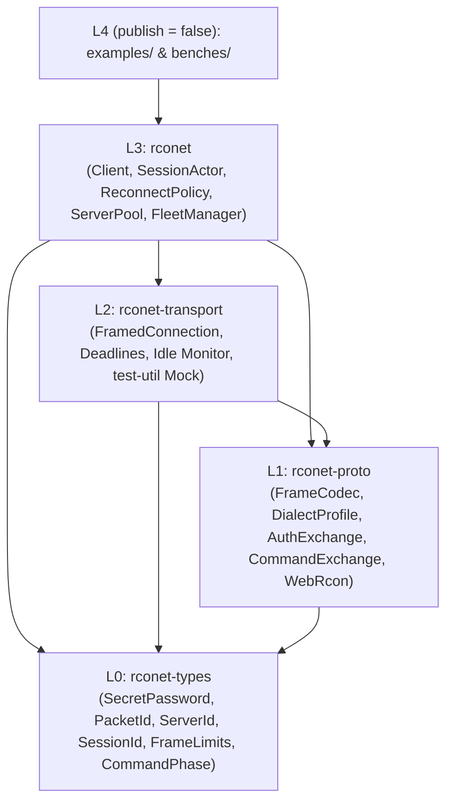

# `rconet` Architecture & Concurrency Model

`rconet` separates wire-level protocol state machines from asynchronous socket I/O and higher-level session orchestration. Directional dependencies are verified continuously by `cargo run -p xtask -- layers`.

---

## 1. Crate Layering (`L0` ➔ `L3`)



### Layer Invariants

1. **Runtime-Independent Core (`L0` + `L1`):** Neither `rconet-types` nor `rconet-proto` depends on Tokio, OS networking APIs, or wall-clock timers. Both crates compile cleanly for `wasm32-unknown-unknown` and can be fuzzed or embedded inside custom event loops synchronously.
2. **Stream-Generic Framed I/O (`L2`):** `rconet-transport::FramedConnection<S>` operates over any `S: AsyncRead + AsyncWrite + Unpin` (Tokio `TcpStream`, TLS/SSH-tunneled streams via `Client::connect_with`, or `tokio::io::DuplexStream` in deterministic tests). Test-only server utilities (`rconet_transport::mock`) are gated behind `feature = "test-util"` so production builds compile zero mock code.
3. **Actor-Managed Concurrency & Idle Monitoring (`L3`):** `rconet::Client` owns a bounded `mpsc` channel to a dedicated `SessionActor` task so concurrent tasks never interleave frames on a half-duplex RCON socket. While idle between commands, `SessionActor` uses a biased `tokio::select!` over `FramedConnection::monitor_idle()` to detect remote `EOF` (`FIN`) or `RST` immediately—transitioning state to `Closed` (evicting dead pooled sockets before the next command) or triggering jittered background reconnection (`ReconnectPolicy::exponential`).

---

## 2. Cancellation-Safe Session Actor

A pervasive failure mode in naive async RCON clients occurs when a caller wraps `client.execute(cmd)` in `tokio::time::timeout(...)` or drops a `select!` branch while the command is already on the wire:
- If the client directly held `&mut TcpStream`, dropping the future leaves the server's unread response frames sitting in the kernel receive buffer.
- The very next command reads the *previous* command's stale response (or fails correlation).

`rconet` eliminates this hazard structurally:

```mermaid
sequenceDiagram
    participant Caller as Caller Future
    participant Queue as Bounded mpsc Queue
    participant Actor as SessionActor Task
    participant Conn as FramedConnection<S>

    Caller->>Queue: SessionRequest::Execute { cmd, options, reply_tx }
    Actor->>Queue: recv()
    alt Caller dropped before socket write
        Note over Actor: reply_tx.is_closed() == true -> skip (Phase = NotSent)
    else Dispatched to socket
        Actor->>Conn: execute_command_with_timeout(cmd, effective_timeout)
        par Caller drops reply_rx mid-flight
            Note over Actor,Conn: Actor retains ownership of Conn and drains all response/sentinel frames!
        and Normal completion
            Conn-->>Actor: Ok(CommandOutput)
            Actor-->>Caller: reply_tx.send(Ok(output))
        end
    end
```

### Exact Cancellation Guarantees

1. **Queued Cancellation (`CommandPhase::NotSent`):** `SessionActor` checks `reply_tx.is_closed()` upon dequeueing a request and again immediately after any reconnect/pacing wait. Cancelled queued commands never touch the socket.
2. **Mid-Flight Cancellation:** Once `FramedConnection::execute_command_with_timeout` begins writing to the stream, `SessionActor` **never** aborts that future when `reply_tx` closes. It finishes reading the correlated response (and sentinel frame, if `TerminationMode::SourceSentinel` is active) within `effective_timeout` so subsequent queued commands observe a clean frame boundary.
3. **Unrecoverable Stream Ambiguity:** If draining times out, hits EOF, receives a mismatched `PacketId`, or encounters a malformed header, `FramedConnection` marks itself unhealthy (`healthy = false`) and `SessionActor` immediately drops and closes the socket (`self.conn = None`) rather than ever reading from a potentially desynchronized stream.

---

## 3. Conservative Command Delivery & Reconnection

TCP writes only confirm bytes copied into the local kernel send buffer—not application-layer receipt or execution on the game server. Similarly, an EOF or timeout while awaiting a response leaves no way to prove whether the server executed the command before dropping.

`rconet-types::CommandPhase` models five explicit lifecycle stages:

| Phase | Wire State | `may_have_executed()` | Safe to Replay Automatically? |
| :--- | :--- | :---: | :--- |
| `NotSent` | Rejected locally (validation, queue full, closed, or queued before socket write) | `false` | Yes — zero bytes touched a socket |
| `Sent` | Command bytes written and flushed | `true` | Only if caller guarantees idempotency |
| `InFlight` | Awaiting correlated response frames | `true` | Only if caller guarantees idempotency |
| `Completed` | Complete response decoded and verified | `true` | Already succeeded |
| `OutcomeUnknown` | Partial write, write timeout, EOF, read timeout, or protocol error after write began | `true` | **Never by default** |

### `ReplayMode` & `ReconnectPolicy`

- **`ReplayMode::NeverReplay` (Default):** Any failure once socket writing starts returns `OutcomeUnknown` immediately to the caller. If `ReconnectPolicy` is enabled, `SessionActor` re-establishes and re-authenticates a fresh connection in the background for *subsequent* commands without replaying the ambiguous command.
- **`ReplayMode::ReplayIdempotentOnly { max_replays }`:** Opts into bounded automatic replay **strictly** for commands where the caller also passed `CommandOptions::new().idempotent()` (for example `"list"` or `"status"`). Mutating commands (`Idempotency::NonIdempotent`, the default) are still never replayed.
- **Credential Rejection Circuit Breaker:** If a server responds with `PacketId == -1` (`Error::AuthRejected`), `SessionActor` transitions permanently to `ConnectionState::Closed` without retrying, preventing accidental IP auto-bans from repeated bad-password handshakes.
- **Bounded Backoff Floor & Jitter:** `ReconnectPolicy::exponential` enforces a `10 ms` minimum floor (`MIN_RECONNECT_DELAY`) and applies `±20%` SplitMix64 jitter per session to prevent synchronized reconnect storms across fleets. `ServerPool` additionally enforces a configurable idle TTL (`ServerPool::with_max_idle`, default `5` minutes) alongside instant `EOF` eviction.

---

## 4. Transport & Protocol Separation (`WebRcon` & `v0.2.0` Roadmap)

WebSocket RCON servers speak a JSON text protocol (`Identifier`, `Message`, `Name`, `Type`, `Stacktrace`) over WebSocket frames. In accordance with strict layer separation:
- `rconet-proto` (`feature = "webrcon"`) implements runtime-independent, size-bounded JSON serialization/deserialization (`WebRconRequest`, `WebRconEvent`, and forward-compatible `WebRconMessageKind` with `#[serde(other)] Unknown`) and distinguishes correlated command replies (`Identifier > 0`) from unsolicited live console/chat broadcasts (`Identifier <= 0`).
- In `v0.1.0`, `rconet-transport` focuses strictly on binary stream/TCP RCON so applications avoid unnecessary HTTP/TLS crate lock-in and can pair `rconet::WebRconRequest` / `WebRconEvent` with any WebSocket client. Managed async WebSocket session transport is scheduled for `v0.2.0`.
